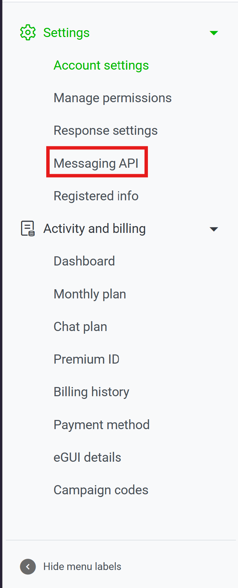
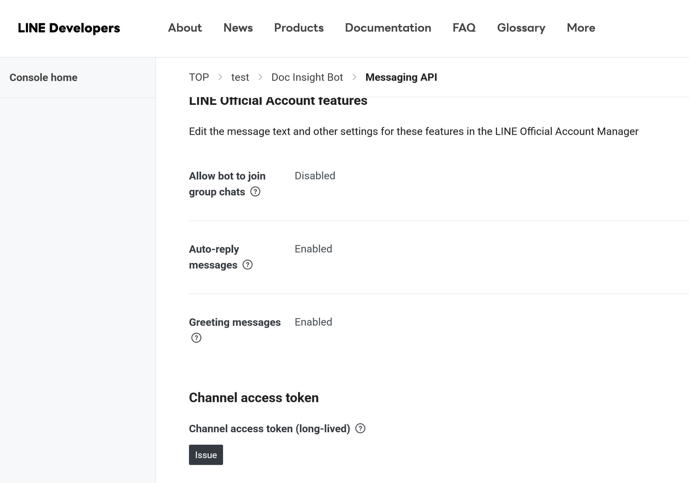

If you want to build a LINE Bot using Python, the first step is to configure a LINE Official Account and enable the Messaging API. In this post, I'll walk through the setup process and show you how to send a test message using Python.

First, log in to [LINE Developers](https://developers.line.biz/en/) and open the Console.

Before getting started, there are two important concepts to understand:

- **Provider:** Used to manage multiple Channels under the same account or organization.
- **Channel:** Represents a specific LINE service, such as the Messaging API or LINE Login.

To get started, create a LINE Official Account if you don't already have one. Then, open the LINE Official Account Manager and navigate to **Settings → Messaging API** to enable the Messaging API.



During this process, you will be asked to select an existing Provider or create a new one. Once completed, LINE will automatically create a Messaging API Channel under the selected Provider.

You can then return to [LINE Developers](https://developers.line.biz/en/) and find your newly created Channel.

Next, navigate to the **Basic settings** tab and locate the **Channel secret** field. Copy its value, as we'll need it later to configure our LINE Bot.

After that, navigate to the **Messaging API** tab and scroll down to the **Channel access token (long-lived)** section.

Click **Issue** to generate a Channel Access Token.



We should now have two important credentials:

- `LINE_CHANNEL_SECRET`
- `LINE_CHANNEL_ACCESS_TOKEN`

To avoid hardcoding sensitive information in our source code, we'll store these credentials in a `.env` file.

You can also find your LINE User ID in the **Basic settings** tab under **Your user ID**. Copy this value as we'll use it to send a test message.

Create a `.env` file in your project directory:

```env
LINE_CHANNEL_SECRET=your_channel_secret
LINE_CHANNEL_ACCESS_TOKEN=your_channel_access_token
LINE_USER_ID=your_user_id
```

Next, create a `requirements.txt` file to manage the Python dependencies required by our project:

```txt
line-bot-sdk==3.27.0
python-dotenv==1.2.4
```

Before installing the packages, let's create a virtual environment to provide an isolated workspace for our project.

```bash
python -m venv .venv

# Linux / macOS
source .venv/bin/activate

# Windows (Command Prompt)
.venv\Scripts\activate.bat
```

Once the virtual environment is activated, install the required packages:

```bash
pip install -r requirements.txt
```

Now that the environment is ready, we can write a simple Python script to test our LINE Bot.

Create a file named `main.py` and add the following code:

```python
import os
from dotenv import load_dotenv

from linebot.v3.messaging import (
    Configuration,
    ApiClient,
    MessagingApi,
    PushMessageRequest,
    TextMessage,
)

# Load environment variables
load_dotenv()

LINE_CHANNEL_ACCESS_TOKEN = os.getenv(
    "LINE_CHANNEL_ACCESS_TOKEN"
)
LINE_USER_ID = os.getenv("LINE_USER_ID")

if not LINE_CHANNEL_ACCESS_TOKEN or not LINE_USER_ID:
    raise ValueError("Missing required environment variables.")

# Configure LINE Messaging API
configuration = Configuration(
    access_token=LINE_CHANNEL_ACCESS_TOKEN
)

# Send a test message
with ApiClient(configuration) as api_client:
    line_bot_api = MessagingApi(api_client)

    message = TextMessage(
        text="Hello, this is a test message from the LINE Bot!"
    )

    request = PushMessageRequest(
        to=LINE_USER_ID,
        messages=[message]
    )

    line_bot_api.push_message(request)
    
```

Finally, run the script:

```bash
python main.py
```

If everything is configured correctly, you should receive a test message from your LINE Official Account.

Make sure you've added your LINE Official Account as a friend before testing the push message. Also, remember to add `.env` to your `.gitignore` file to prevent accidentally exposing your credentials when pushing code to GitHub.

From here, you can extend it to handle incoming messages, integrate with external APIs, or build your own automated notification system.

Hope this post helps you get started with LINE Bot development!